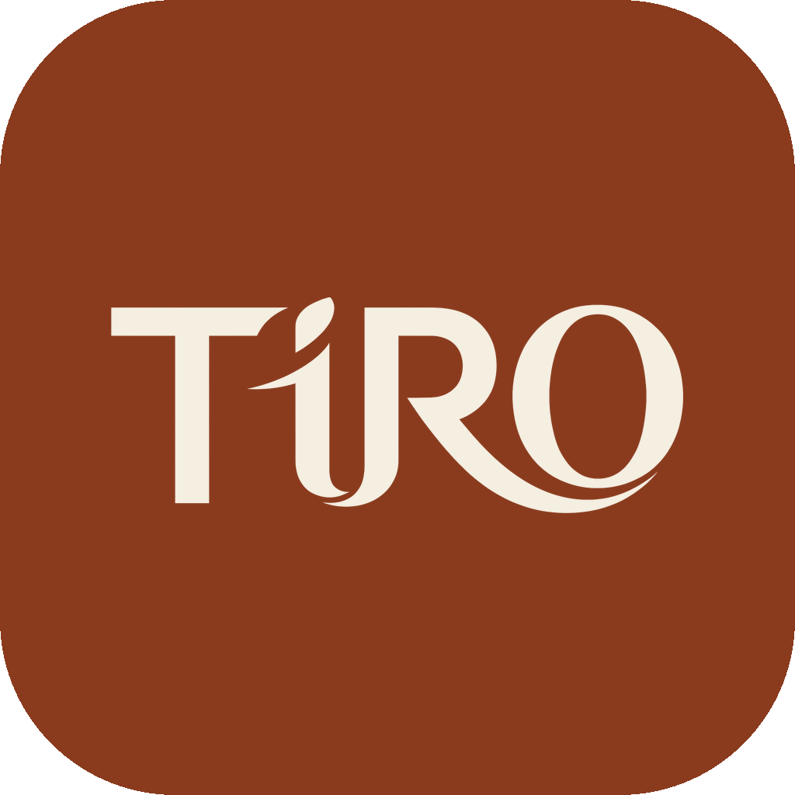

<p align="center"></p>

# Tiro desktop

Jamie's assistant on the Windows screen, and the PC half of [Tiro](https://tiro.jamies.dev). It sits beside the
cursor, listens while you hold **Ctrl+Alt**, opens a text box when you tap **Ctrl+Shift**, sees the screen, points
at things, and can read and work other apps (with your OK). It talks in its own Fish Audio voice.

## Install

Download `Tiro-setup.exe` from the newest release of this repo and run it. Windows SmartScreen warns the first
time (More info > Run anyway): the installer isn't code-signed. Installed copies update themselves from this repo's
releases (a signed update feed).

## How it's built

| Part | Where | What it does |
| ---- | ----- | ------------ |
| Shell | `app/tauri/src-tauri` (Rust, Tauri 2) | tray icon, overlay windows, TiroDash, setup guide, shortcuts, updates |
| Sidecar | `app/tauri/sidecar` (Node) | the agent: model, tools, memory, voice, Tiro server tools (`tiro.mjs`) |
| Overlay | `app/overlay` (browser JS) | the character, bubbles, cards, drawings and the type-to-ask bar |
| TiroDash | `app/dashboard` (+ `app/panel` in its frame) | the one window: TiroCloud, This PC, Settings, Tiro sign-in |
| Setup guide | `app/onboarding` | first-run setup |
| Voice helper | `app/tauri/src-tauri/voice-win` (Rust) | talk keys, microphone and speech-to-text (Parakeet, on the PC) |
| Hands helper | `app/tauri/src-tauri/hands-win` (Rust) | windows, screenshots, UI Automation and OCR, typing and clicking |

Your data lives in `%USERPROFILE%\.tiro` (settings, memory, logs); see [PRIVACY.md](PRIVACY.md).

## Building

GitHub Actions (`.github/workflows/tiro-windows.yml`) tests and builds every push on Windows; only `main` publishes
a release (v0.2.&lt;run&gt;), which installed copies pick up. To build on a Windows PC:

```sh
cd app/tauri/sidecar && npm ci && npm test
cd .. && ./build.sh release --target x86_64-pc-windows-msvc
```

## Based on Roamies

Tiro desktop started as a fork of [Roamies](https://github.com/KenKaiii/Roamies) by Ken Kai (AGPL-3.0, © Ken Kai),
and is AGPL-3.0 too (see [LICENSE](LICENSE) and [THIRD_PARTY_NOTICES.md](THIRD_PARTY_NOTICES.md)). What changed:

- **2026-11-17, split into its own app:** Tiro's name, icon, colours and personality throughout, including the code
  (`window.Tiro`, `TIRO_*` settings, `tiro.exe`, `tiro-voice`, `tiro-hands`); settings and data in `~/.tiro` (moved
  from `~/.gg` on first start); Windows only (the macOS and Linux code, Swift helpers and their builds were removed);
  one look (Tiro, with its own Fish Audio voice) instead of Roamies' looks; focus mode and game mode removed;
  updates from this repo only; Roamies' release notes and community links replaced.
- **Tiro tools** (`app/tauri/sidecar/tiro.mjs`): ask the Tiro server, send to the phone, save to the inbox, add a
  to-do, set a reminder, and read the highlighted text in the app in front.

The agent runs on Ken Kai's [gg-framework](https://github.com/KenKaiii/gg-framework) (AGPL-3.0).
